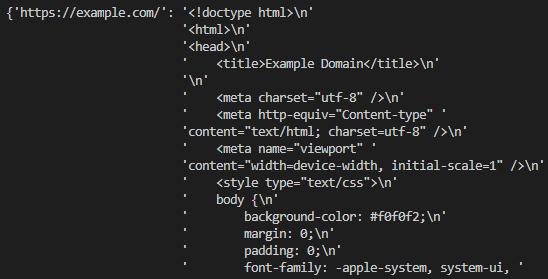

# Request Freezer

A lightweight Python utility for caching HTML/text content in Redis so repeated requests to the same page do not hammer the source website during prototyping or scraping workflows.



## Why this project exists

When building scrapers or quick prototypes, it is common to request the same page multiple times while testing logic. `Request Freezer` keeps the page content in Redis and reuses it until the next midnight, which keeps the number of outbound requests low and avoids unnecessary load.

## Features

- Stores fetched page content under the URL as the Redis key
- Reuses cached content on subsequent lookups
- Refreshes the entry automatically at the next midnight
- Provides a simple context manager for Redis connections
- Includes a sample scraper that prints the page title from a cached response

## How it works

The `Freezer` class wraps a Redis connection and exposes helpers to:

- connect to Redis
- fetch a page from cache or the network
- save page content to Redis
- list cached entries
- truncate the returned body to a configured character limit

The cache expiration is calculated as the number of seconds until the next midnight:

```python
# expire_time = number of seconds until the next day
self.redis_client.expire(url, expire_time)
```

## Requirements

- Python 3.9+
- Redis server running locally
- Python packages:
  - `redis`
  - `requests`
  - `beautifulsoup4`

## Installation

```bash
pip install redis requests beautifulsoup4
```

## Start Redis

This repository includes a sample Redis config file:

```bash
redis-server redis.conf
```

If your Redis is already running on the default local port, this project can connect to it without additional configuration.

## Run the example

```bash
python main.py
```

The sample script in `main.py` connects to Redis at `127.0.0.1:6379`, fetches `https://example.com/`, caches the content, and prints the page title.

## Example usage

```python
from freezer import Freezer

freezer = Freezer(address="127.0.0.1", port=6379)

with freezer.connection():
    content = freezer.get_page_content("https://example.com/", char_limit=3000)
    print(content[:200])
```

## API overview

### `Freezer(address, port, max_retries=3, retry_delay=1.0)`

Creates the Redis-backed freezer instance.

### `with freezer.connection():`

Opens the Redis client connection and closes it automatically at the end of the block.

### `freezer.get_page_content(url, char_limit=3000)`

Returns the page content from Redis if cached; otherwise fetches it from the network, stores it, and then returns the content truncated to the requested size.

### `freezer.list_cached_websites()`

Returns a dictionary of the cached Redis keys and their values.

## Notes

- This is intentionally simple and aimed at prototyping, not a production-grade cache layer.
- It stores page content as plain text, so it is best suited for content that does not require complex parsing or large object storage.
- The expiration is tied to the end of the current day, so a page is refreshed once per day by default.

